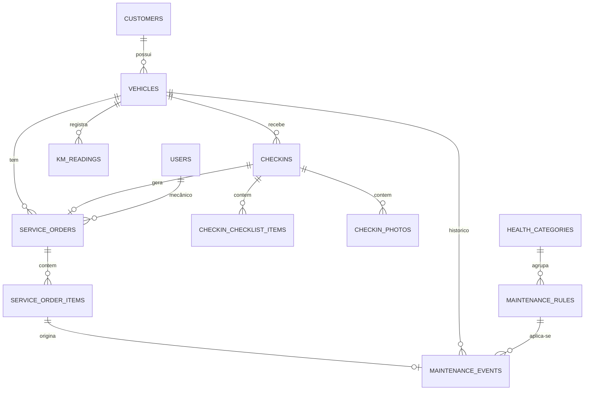

# Auto Center — Design (MVP 4 dias)

Projeto Integrado UNIFEOB — Computação em Nuvem. Sistema interno de gestão para Auto Center.

## 1. Escopo do MVP

**Entra:** autenticação JWT (Admin, Recepção, Mecânico), clientes, veículos, check-in (checklist + fotos S3), ordem de serviço (6 status, itens de serviço/peça), motor de manutenção preventiva, índice de saúde do veículo, histórico do veículo, dashboard de alertas.

**Backlog (documentado, fora do MVP):** estoque completo, financeiro, relatórios, auditoria completa, CloudWatch avançado, Route 53, manual do usuário detalhado.

## 2. Arquitetura

```
Browser -> Nginx (HTTPS) -> /        estáticos do React (dist)
                         -> /api/*   FastAPI (uvicorn, systemd) -> RDS MySQL
                                                               -> S3 (fotos, URL pré-assinada)
GitHub Actions: push em main -> testes -> build -> deploy SSH na EC2 -> alembic upgrade -> restart
```

- Uma única EC2 Ubuntu serve Nginx + API. RDS MySQL em subnet privada (SG só aceita a EC2).
- A EC2 acessa o S3 por **IAM Role** (sem chaves no código). Fotos: upload/leitura via URL pré-assinada.
- Segredos em variáveis de ambiente (`.env` fora do git) e GitHub Secrets.

## 3. Backend — Clean Architecture (FastAPI)

```
backend/app/
  domain/           entidades puras, regras (maintenance engine, health score), interfaces de repositório
  application/      services (casos de uso), DTOs (Pydantic)
  infrastructure/   SQLAlchemy models, repositórios MySQL, S3, segurança (JWT, hash), config
  presentation/     routers FastAPI, dependências (DI), handlers globais de exceção
  alembic/          migrations
  tests/            unit (domain) + integração (API)
```

Padrões: Repository, Service Layer, DI via `Depends`, DTOs Pydantic, soft delete (`deleted_at`), paginação/filtros/busca nas listagens, log estruturado, handler global de erros, RBAC por dependência (`require_role`).

## 4. Entidades (DER)



| Tabela | Campos principais |
|---|---|
| users | id, name, email (único), password_hash, role (admin/reception/mechanic), active, timestamps, deleted_at |
| customers | id, name, document, phone, email, notes, timestamps, deleted_at |
| vehicles | id, customer_id, plate (única), brand, model, year, engine, fuel, color, chassis, renavam?, current_km, timestamps, deleted_at |
| km_readings | id, vehicle_id, km, source (checkin/os/manual), created_at |
| checkins | id, vehicle_id, user_id, km, fuel_level, damages, accessories, notes, created_at |
| checkin_checklist_items | id, checkin_id, item (pneus, suspensão, freios, iluminação, bateria, ar-cond., limpadores), condition (ok/atenção/crítico), note |
| checkin_photos | id, checkin_id, s3_key, content_type, created_at |
| service_orders | id, vehicle_id, checkin_id?, mechanic_id?, reported_issue, diagnosis, labor_cost, total, due_date, status, timestamps, deleted_at |
| service_order_items | id, service_order_id, kind (service/part), description, qty, unit_price, rule_code? |
| health_categories | id, code (motor, lubrificação, freios, suspensão, pneus, direção, elétrico, arrefecimento, transmissão), name, weight |
| maintenance_rules | id, code, name, category_id, interval_km?, interval_days?, warn_pct (padrão 10), active — **configurável pelo Admin** |
| maintenance_events | id, vehicle_id, rule_id, done_km, done_date, service_order_item_id? |

Status da OS: `aberta → aguardando_orcamento → aguardando_aprovacao → em_execucao → finalizada → entregue` (transições validadas no domínio).

Auditoria (MVP): `created_by/updated_by` + timestamps nas tabelas principais; tabela `audit_log` completa fica no backlog.

## 5. Motor de Manutenção Preventiva

Para cada veículo × regra ativa, usando o último `maintenance_event` (ou a data/km de cadastro se nunca feito):

- `next_due_km = done_km + interval_km`; `next_due_date = done_date + interval_days`
- Estado: `overdue` se km atual ≥ next_due_km **ou** hoje ≥ next_due_date; `upcoming` se faltar ≤ `warn_pct`% do intervalo; senão `ok`. Vale o pior dos dois critérios (km e tempo).
- Disparo: ao registrar nova quilometragem (`km_readings`) o service recalcula os estados do veículo. Os estados são calculados sob demanda por função pura do domínio (sem tabela de cache no MVP), então o dado nunca fica defasado.
- Regras iniciais (seed): troca de óleo, rodízio, alinhamento, balanceamento, filtros de ar/cabine, correia dentada, fluido de freio, arrefecimento, velas, bateria, palhetas, pneus. IPVA, licenciamento e seguro entram como regras só por tempo (`interval_km` nulo).

## 6. Índice de Saúde (0–100)

Por categoria: `score = 100 − Σ penalidades` (overdue = −100% do peso da regra na categoria, upcoming = −40%), limitado a 0–100. Nota final = média ponderada pelos pesos de `health_categories`. A resposta traz: nota, itens críticos (overdue), próximos (upcoming) e recomendações geradas a partir das regras.

## 7. API (resumo)

`/api/v1`: `auth/login`, `auth/me`, `users`, `customers`, `vehicles` (+ `/{id}/km`, `/{id}/health`, `/{id}/maintenance`, `/{id}/history`), `checkins` (+ `/{id}/photos/presign`), `service-orders` (+ `/{id}/status`, `/{id}/items`), `maintenance-rules`, `dashboard/summary`, `dashboard/alerts`. Swagger em `/docs`.

Permissões: Admin tudo; Recepção clientes/veículos/check-in/OS; Mecânico lê OS atribuídas, atualiza diagnóstico/itens/status de execução.

## 8. Frontend

React + TS + Vite + Tailwind + React Router + React Query. Estrutura por feature:

```
frontend/src/
  app/ (router, providers, layout)   shared/ (api client, ui, hooks)
  features/{auth,customers,vehicles,checkins,service-orders,maintenance,dashboard}/
```

Telas: login, dashboard (KPIs + alertas), clientes, veículos (detalhe com saúde, próximos serviços e histórico), check-in, OS (lista + detalhe), configuração de regras (Admin).

## 9. CI/CD e Deploy (GitHub Actions)

- `ci.yml` (PR e push): lint + pytest (backend), build + typecheck (frontend).
- `deploy.yml` (push em `main`, após CI): build do frontend, `rsync` de backend + `dist` para a EC2 via SSH (chave em GitHub Secrets), `pip install`, `alembic upgrade head`, `systemctl restart autocenter-api`, Nginx recarregado.
- Infra documentada em `docs/infra/` (passo a passo: VPC/SGs, RDS, EC2 + IAM Role, S3 com CORS, Nginx, HTTPS com Certbot se houver domínio).
- Se o ambiente for AWS Academy/Learner Lab: usar `LabRole` como instance profile, sem Route 53 real, e HTTPS só com domínio próprio. Decisão final depende do tipo de conta (pendente).

## 10. Plano de 4 dias

| Dia | Entrega |
|---|---|
| 1 | Estrutura do repo, backend base (config, DB, Alembic, auth JWT/RBAC, handlers), CI, **infra AWS criada** (EC2, RDS, S3) e primeiro deploy "hello" automático |
| 2 | Clientes, veículos, km_readings, check-in com fotos S3, OS com transições de status |
| 3 | Motor preventivo, índice de saúde, histórico, dashboard de alertas; testes do domínio |
| 4 | Frontend finalizado e polido, README, manual de implantação, Swagger, ajustes, ensaio da apresentação |

O frontend avança em paralelo a partir do dia 2, consumindo a API.

## 11. Riscos

- Acesso à AWS ainda não confirmado (conta própria vs Learner Lab) — define o dia 1.
- HTTPS exige domínio; sem domínio, usar certificado autoassinado ou apresentar em HTTP e documentar o caminho para produção.
- 4 dias é apertado: se atrasar, o frontend de configuração de regras e o financeiro são os primeiros cortes.
